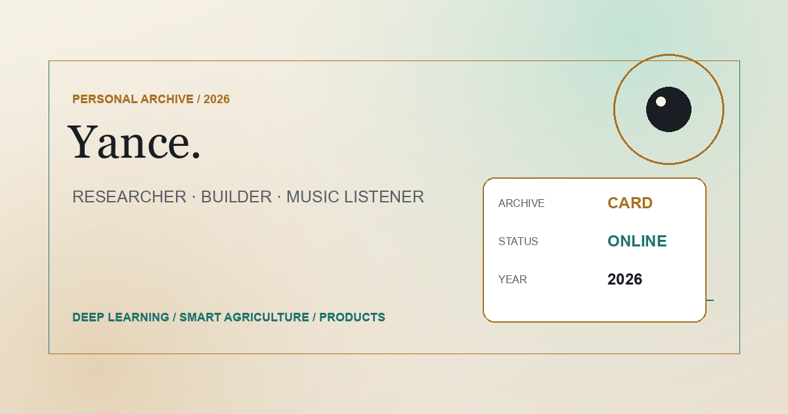

# Yance · Personal Archive

[English](#english) · [简体中文](#简体中文)

## English

A quiet, content-first personal archive for academic work, research, selected projects, and live-music memories.

[Visit yance.me](https://yance.me/)

[](https://yance.me/)

The site includes Home, Academics, Honors, Research, Works, and Concerts pages. It supports Simplified Chinese, Traditional Chinese, and English; light and dark themes; responsive layouts; keyboard access; and reduced-motion preferences.

### Technology

Vue 3, TypeScript, and Vite 8. The sitemap lists 18 localized routes: 15 are prerendered to static HTML at build time, while the 3 Concerts routes are client-rendered with a build-time no-JavaScript fallback. GitHub Actions publishes the generated site to GitHub Pages. The site has no runtime backend.

### Run locally

Requirements: Node.js `>=22.12.0`, npm `>=10.9.0`. Python tools use the pinned packages in [`scripts/requirements.txt`](scripts/requirements.txt).

```bash
npm ci
npm run dev
```

Run the repository checks with `npm run check`. See the [contribution guide](.github/CONTRIBUTING.md) for browser testing and other development details.

### Repository map

| Path | Contents |
| --- | --- |
| `src/components/`, `src/pages/` | Reusable Vue components and page views |
| `src/composables/`, `src/directives/`, `src/styles/`, `src/utils/` | Shared interaction logic, directives, styles, and utilities |
| `src/data/`, `src/data/locales/`, `src/i18n/` | Shared and localized page data, translations, and locale state |
| `html-src/` | Source HTML files used by the build |
| `public/` | GitHub Pages metadata, including `CNAME`, `robots.txt`, and `sitemap.xml` |
| `public/assets/` | Site images, fonts, and other static resources |
| `scripts/` | Build, asset-generation, and audit tools |
| `config/` | Vite, TypeScript, lint, test, and Lighthouse configuration |
| `tests/` | Unit, browser, accessibility, and visual checks |

### Build, deployment, and media rights

`npm run build` creates the GitHub Pages artifact in `dist/`. The Pages workflow deploys it to [yance.me](https://yance.me/); generated `dist/` files are not committed.

The repository has no general reuse license. Public visibility does not grant permission to reuse the site's photos, fonts, or third-party media. Read the [asset rights guide](docs/asset-rights.md) before using assets, and see the [contribution guide](.github/CONTRIBUTING.md) for project changes.

## 简体中文

这是一个以内容为先的个人档案网站，整理学业、研究、精选作品与现场记忆。

[访问 yance.me](https://yance.me/)

[](https://yance.me/)

网站包含首页、学业、荣誉、研究、作品和演唱会页面，支持简体中文、繁体中文和英文，以及浅色与深色主题。布局适配桌面和手机，并支持键盘操作与减少动态效果偏好。

### 技术栈

Vue 3、TypeScript 和 Vite 8。站点地图共 18 个本地化路由：其中 15 个在构建期预渲染为静态 HTML，演唱会 3 个路由由客户端渲染，并提供构建期无 JavaScript 降级内容。站点由 GitHub Actions 发布到 GitHub Pages；没有运行时后端。

### 本地启动

环境要求：Node.js `>=22.12.0`、npm `>=10.9.0`。Python 工具依赖见 [`scripts/requirements.txt`](scripts/requirements.txt)。

```bash
npm ci
npm run dev
```

运行仓库检查：`npm run check`。浏览器测试及其他开发说明见[贡献指南](.github/CONTRIBUTING.md)。

### 目录结构

| 路径 | 内容 |
| --- | --- |
| `src/components/`、`src/pages/` | 可复用 Vue 组件与页面视图 |
| `src/composables/`、`src/directives/`、`src/styles/`、`src/utils/` | 共享交互逻辑、指令、样式与工具 |
| `src/data/`、`src/data/locales/`、`src/i18n/` | 页面数据、多语言内容、界面翻译与语言状态 |
| `html-src/` | 构建使用的 HTML 源文件 |
| `public/` | GitHub Pages 部署元数据，包括 `CNAME`、`robots.txt` 和 `sitemap.xml` |
| `public/assets/` | 网站图片、字体与其他静态资源 |
| `scripts/` | 构建、资源生成与审计工具 |
| `config/` | Vite、TypeScript、lint、测试与 Lighthouse 配置 |
| `tests/` | 单元、浏览器、无障碍与视觉检查 |

### 构建、部署与资源权利

运行 `npm run build` 会在 `dist/` 生成 GitHub Pages 发布产物。Pages 工作流将其部署到 [yance.me](https://yance.me/)；`dist/` 是构建产物，不提交到仓库。

仓库没有通用的素材复用许可。仓库公开可见不代表可以复用网站照片、字体或第三方媒体。使用素材前请阅读[资源权利说明](docs/asset-rights.md)；修改项目请参阅[贡献指南](.github/CONTRIBUTING.md)。
